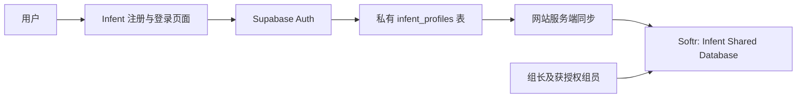

# Infent 账号与团队共享数据库

## 用户实际使用的流程

用户在 Infent 的 `/register` 填写姓名、邮箱、密码。Supabase Auth 创建账号并发送验证邮件；用户在同一浏览器打开验证链接后进入网站。以后在 `/login` 使用自己的邮箱、密码登录，通过 `/account` 查看自己的资料并退出。

注册、邮箱验证和登录事件会更新私有 `infent_profiles` 表。网站后台把姓名、邮箱、认证账号编号、注册时间、最近登录时间、账号状态同步到 Softr 的 Users 表。密码、登录令牌及服务端密钥不写入 Softr。



## 已建立的云端资源

- Supabase 组织：Infent Team，Free。
- Supabase 项目：Infent Accounts。
- 项目管理：https://supabase.com/dashboard/project/xkqvmqyseunbeaipheyq
- 网站认证资料表：`public.infent_profiles`。建表和触发器已通过 SQL Editor 执行，返回 Success。
- Softr 数据库：Infent Shared Database。
- 数据库管理：https://studio.softr.io/databases/49fb0a81-0450-47e7-8a08-ecbfa8e2c082

| 数据表 | 内容 | 关联 |
| --- | --- | --- |
| Users | 姓名、邮箱、网站账号 ID、注册与登录时间 | 一名用户对应多条 Progress |
| Modules | 课程标题、分类、内容、顺序、预计时长 | 一门课程对应多条 Progress |
| Progress | 用户、课程、学习状态、完成日期 | User → Users；Module → Modules |

原来的 Table 1 保留。Users 中现有六位成员是人工预置资料，不是已经注册或登录的证明。网站注册字段只由真实认证事件写入。学习室的浏览器进度已按认证用户 ID 隔离；本次账号连接不把浏览器课程进度冒充为云端完成记录。

### Softr Users 字段映射

| 字段 | 类型 | 字段 ID |
| --- | --- | --- |
| Name | Short text | `lEehx` |
| Email | Email | `ULDyS` |
| CreatedAt | Date | `uQNi9` |
| AuthUserId | Short text | `tQzYN` |
| RegisteredAt | Date and time | `zJY8Z` |
| LastLoginAt | Date and time | `AzaZz` |
| AuthStatus | Select | `OiDYX` |

AuthStatus 使用 Pending Verification / Active。人工预置用户保持认证字段为空。邮箱已统一成小写以便注册时匹配；原有课程关联保留。

## 六位组员与普通用户

Softr **工作区协作者**可以编辑被授权的应用或数据库；Infent **产品用户**通过网站注册，只使用自己的账号。给 Users 表添加一行不会让某人成为工作区编辑成员。

组长作为工作区所有者管理共享数据库。其他五位成员需要各自创建 Softr 工作账号，再由组长按实际工作需要邀请到同一个团队，并选择查看或编辑权限。邀请前应确认邮箱、权限、当前套餐允许的协作者人数。还没有发送团队邀请或开放公共数据链接。

普通用户不能因为注册就获得整个用户列表。Supabase 的 infent_profiles 已开启 RLS，并移除 anon / authenticated 的整表权限；只有服务端服务角色可读写同步状态。SQL 后续只读权限核查曾遇到 Supabase API 网络错误，需在项目网络恢复后再次读取确认。

## 本地连接配置

1. 在项目根目录建立 `.env.local`，参考 `.env.example`。不要提交 `.env.local`。
2. 配置以下值，服务端密钥不能使用 `NEXT_PUBLIC_` 前缀：

```dotenv
NEXT_PUBLIC_SUPABASE_URL=https://xkqvmqyseunbeaipheyq.supabase.co
NEXT_PUBLIC_SUPABASE_PUBLISHABLE_KEY=<Supabase publishable key>
SUPABASE_SECRET_KEY=<Supabase server secret key>
SOFTR_API_KEY=<Softr token with access to this database>
SOFTR_DATABASE_ID=49fb0a81-0450-47e7-8a08-ecbfa8e2c082
SOFTR_USERS_TABLE_ID=O9N2m0m0P3H8pI
CRON_SECRET=<private random bearer secret for the retry job>
```

3. Supabase → Authentication → URL Configuration：本地 Site URL 设置为 `http://localhost:3011`；允许 Redirect URL `http://localhost:3011/auth/callback`。上线时同时添加自己的正式域名回调地址。
4. 保留邮箱验证。测试人员各自设置新密码；不要通过聊天收集密码。
5. 若从空白项目重新开始，在 Supabase SQL Editor 执行 `supabase/migrations/202610230001_infent_profiles.sql`。当前项目已执行过。
6. 安装依赖后运行 `npx next dev -H 127.0.0.1 -p 3011`，或使用已准备的 `start-local.command`。该快捷脚本固定端口 3011。
7. 打开 `http://localhost:3011/register`。同一个用户后续登录应更新原记录，而不是再增加人数。

注册与登录会立即尝试同步。Softr 暂时故障时，注册资料保留在私有表中，下一次登录和每日重试任务会继续处理。已有人工资料只有在邮箱验证后才会与网站身份绑定。Softr 本身没有给 AuthUserId 添加唯一约束：服务端使用 Postgres 租约串行处理同一账号，并在写入前检查匹配与冲突；若人工创建重复行，程序停止写入并留待处理。

## 部署与最终验收

Vercel 环境变量配置完成后，每日 Cron 调用 `/api/internal/softr-sync`。它要求 `Authorization: Bearer <CRON_SECRET>`，不接受浏览器提供任意用户 ID 来同步别人。每次部署环境需配置对应的真实回调域名。

1. 一个新的真实邮箱注册，完成邮箱验证。
2. Softr 的 Website Registrations 视图出现该用户，AuthUserId / RegisteredAt 有真实值。
3. 退出并重新登录，记录数不增加，LastLoginAt 更新。
4. 第二个用户重复流程；确认不能查看前一个用户的私有资料。
5. 保存真实结果和截图，更新 Kanban；不要把种子资料写成真人测试成果。

代码检查已完成：全部 29 个离线测试通过（其中新增 8 个认证和同步测试）；TypeScript、ESLint 和 Next.js 生产构建通过。本地浏览器已查看注册页面。尚未使用真实用户完成注册、邮件验证、登录与 Softr API 连通测试，因为连接密钥尚未配置。原有学习室浏览器测试需要有效的认证测试账号后再运行。
